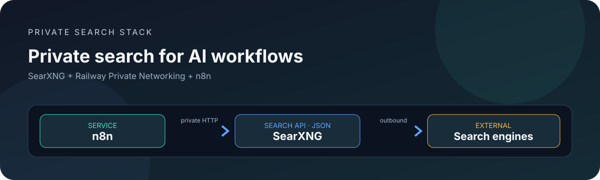
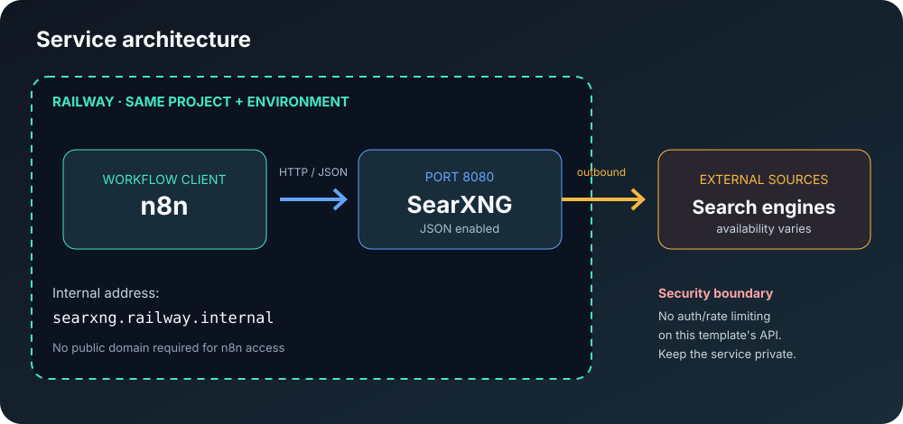

<div align="center">


# SearXNG Railway

<p>
    <a href="https://github.com/DURIAN-ORGANISASI/searxng-railway/actions/workflows/validate.yml"></a>
    
    
    
    
  </p>

<p><a href="README.md">🇮🇩 Bahasa Indonesia</a> · <a href="README.en.md">🇬🇧 English</a></p>

<p><strong>Deploy private SearXNG on Railway.</strong><br>
Connect it to n8n over the internal network.</p>

<p>
    <a href="#overview">Overview</a> · <a href="#features">Features</a> · <a href="#architecture">Architecture</a> ·
    <a href="#deploy-to-railway">Deploy</a> · <a href="#connect-to-n8n">n8n integration</a> ·
    <a href="#troubleshooting">Troubleshooting</a> · <a href="#security-and-privacy">Security</a> ·
    <a href="#sources-attribution-and-licensing">Sources &amp; license</a>
  </p>

</div>



<p align="center"><sub>Original documentation illustration. This independent project is not an official SearXNG, Railway, or n8n product.</sub></p>

> [!WARNING]
> **Keep this service private.** The configuration disables the limiter for internal use and does not add API authentication to the search endpoint. Do not create a public Railway domain for this service. Use it only from n8n or trusted services in the **same Railway project and environment**. SEARXNG_SECRET is an internal SearXNG secret, not an API key or access-control mechanism.

## Overview

This repository wraps the upstream SearXNG image with configuration that enables JSON search responses for the **built-in SearXNG node in n8n**. The goal is to connect both services over Railway private networking without publishing the search endpoint to the internet.

## Features

- **n8n integration:** enables JSON responses from the SearXNG Search API.
- **Private networking:** documents the Railway internal hostname based on the service name searxng.
- **Random secret generation:** PowerShell and shell helpers create a 256-bit secret.
- **Minimal configuration:** preserves upstream defaults and changes only what the integration needs.
- **Professional documentation:** architecture diagram, official references, license scope, security policy, and troubleshooting.
- **Automated validation:** GitHub Actions checks configuration, documentation, local links, SVGs, and shell syntax.

## Architecture



| Component | Role |
| --- | --- |
| **n8n** | Sends queries and receives JSON results. |
| **SearXNG** | Aggregates results from external search engines. |
| **Railway private network** | Connects services without exposing SearXNG publicly. |
| **External search engines** | Provide results; CAPTCHAs, rate limits, and availability are outside this template's control. |

## Requirements

- A Railway account and GitHub repository.
- n8n and SearXNG in the **same Railway project and environment**.
- SearXNG listening on port **8080**.
- No public domain is required for n8n to connect over private networking.

## Deploy to Railway

### 1. Add a service

1. Open the Railway project and environment that already runs n8n.
2. Select **New → GitHub Repo** and choose this repository.
3. Keep Root Directory empty so Railway uses the root Dockerfile.
4. Name the service **searxng** so the example internal hostname works.

### 2. Generate a strong secret

Run from the repository root.

PowerShell:

```powershell
.\scripts\generate-secret.ps1
```

Linux/macOS:

```sh
sh scripts/generate-secret.sh
```

Copy the result into **SearXNG service → Variables** as ```SEARXNG_SECRET```. Store it in a password manager. Never commit it or put it in README files, issues, or logs.

### 3. Deploy privately

1. Deploy the service and wait until it is active.
2. **Do not generate a public domain** for this internal setup.
3. If Railway requires a manual health check, use path **/healthz** on port **8080**.
4. Inspect Deploy Logs if startup fails. A successful build does not prove that n8n can reach the API.

### 4. What is configured?

The settings.yml file preserves upstream defaults with use_default_settings enabled and adds json to search.formats. The SEARXNG_SECRET environment variable overrides SearXNG's internal secret at runtime through the upstream image configuration. Do not remove JSON support when n8n depends on it.

## Connect to n8n

1. Ensure n8n is in the same Railway project and environment.
2. In n8n, create or open a **SearXNG** credential.
3. Set **API URL** to the base URL below; do not append /search:

   `http://searxng.railway.internal:8080`

4. Save the credential and select it in the SearXNG node.
5. Test with a simple query and 5–10 results first.

**Do not enter SEARXNG_SECRET into the n8n credential.** The native SearXNG credential asks for an API URL. The secret is used internally and does not authenticate HTTP requests.

### Test the Search API

From a service on the same private network:

```sh
curl --fail --silent --show-error \
  'http://searxng.railway.internal:8080/search?q=n8n&format=json'
```

The expected response is JSON containing query and results. If you rename the service, update the hostname in the n8n credential.

## Repository structure

| Path | Purpose |
| --- | --- |
| **Dockerfile** | Selects the upstream SearXNG image and copies local configuration. |
| **settings.yml** | Enables JSON and keeps public-instance mode disabled. |
| **scripts/generate-secret.ps1** | Secret generator for Windows PowerShell. |
| **scripts/generate-secret.sh** | OpenSSL-based secret generator for Linux/macOS. |
| **docs/SOURCES.md** | Upstream references, attribution, and license boundaries. |
| **CONTRIBUTING.md / SECURITY.md** | Contribution guide and vulnerability reporting policy. |

## Troubleshooting

| Problem | What to check |
| --- | --- |
| **403 Forbidden** for JSON format | Ensure the deployed image contains the latest settings.yml and search.formats includes json. |
| n8n cannot reach the hostname | Confirm both services share a project/environment, the service is named searxng, and the app listens on port 8080. |
| n8n asks for an API URL | Enter the internal base URL; do not use SEARXNG_SECRET or append /search to the credential. |
| Health check fails | Verify the application port; inspect logs and /healthz if health checking is enabled. |
| Empty or slow search results | External engines may throttle requests, show CAPTCHAs, experience outages, or change policies. |
| Works from n8n but not from a laptop browser | Expected for a private Railway hostname; the internal address is not public browser access. |

## Security and privacy

- Do not expose this unauthenticated endpoint to the internet. The configuration sets limiter to false, so it is not suitable as a public instance.
- SEARXNG_SECRET is not an API key, login, or access control for the search endpoint.
- For public access, add and test authentication, access restrictions, rate limiting, monitoring, and abuse protections first.
- Queries may be forwarded to external search engines enabled in SearXNG. Do not send secrets or sensitive data in search queries.
- Never commit tokens, secrets, .env files, or logs containing sensitive information.
- Read [SECURITY.md](SECURITY.md) for the security policy.

## Sources, attribution, and licensing

Read [docs/SOURCES.md](docs/SOURCES.md) for official references and attribution details.

- **This template:** original installer and documentation materials owned by this repository are covered by the [MIT License](LICENSE).
- **SearXNG upstream:** licensed under **GNU AGPL-3.0**. This repository's MIT license does not replace the license of the SearXNG software or Docker image.
- **Railway, n8n, and search engines:** remain subject to their respective licenses, trademarks, policies, and terms of service.

> [!IMPORTANT]
> The Dockerfile uses the **latest** image tag, so new builds may pull a different upstream version. For production, consider pinning a tested tag or digest and review the applicable license obligations.

## Validation and contributing

Run from the repository root:

```sh
python3 scripts/validate_repo.py
python3 scripts/check_docs.py
sh -n scripts/generate-secret.sh
```

These checks validate repository consistency and documentation, not a live Railway deployment or n8n workflow. Read [CONTRIBUTING.md](CONTRIBUTING.md) before submitting changes.
