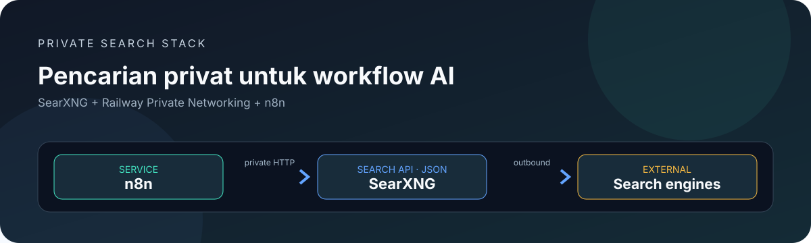

<div align="center">


<h1>SearXNG Railway</h1>

<p>
    <a href="https://github.com/DURIAN-ORGANISASI/searxng-railway/actions/workflows/validate.yml"></a>
    
    
    
    
  </p>

<p><a href="README.md">🇮🇩 Bahasa Indonesia</a> · <a href="README.en.md">🇬🇧 English</a></p>

<p><strong>Deploy SearXNG privat di Railway dan hubungkan ke n8n melalui jaringan internal.</strong></p>

<p>
    <a href="#ringkasan">Ringkasan</a> · <a href="#fitur">Fitur</a> · <a href="#arsitektur">Arsitektur</a> ·
    <a href="#deploy-ke-railway">Deploy</a> · <a href="#hubungkan-ke-n8n">Integrasi n8n</a> ·
    <a href="#troubleshooting">Troubleshooting</a> · <a href="#keamanan-dan-privasi">Keamanan</a> ·
    <a href="#sumber-atribusi-dan-lisensi">Sumber &amp; lisensi</a>
  </p>

</div>



<p align="center"><sub>Ilustrasi dokumentasi orisinal. Proyek ini independen dan bukan produk resmi SearXNG, Railway, atau n8n.</sub></p>

> [!WARNING]
> **Pertahankan service ini privat.** Konfigurasi ini menonaktifkan limiter untuk penggunaan internal dan endpoint pencarian tidak memiliki autentikasi API. Jangan membuat public domain Railway untuk service ini. Gunakan hanya dari n8n atau service tepercaya di **project dan environment Railway yang sama**. Variabel **SEARXNG_SECRET** adalah secret internal SearXNG, bukan API key dan bukan mekanisme pembatas akses.

## Ringkasan

Repository ini membungkus image upstream SearXNG dengan konfigurasi agar hasil pencarian JSON dapat dikonsumsi oleh **SearXNG node bawaan n8n**. Tujuannya adalah menghubungkan dua service melalui jaringan privat Railway tanpa mempublikasikan endpoint pencarian ke internet.

## Fitur

- **Integrasi n8n:** mengaktifkan format respons JSON pada Search API SearXNG.
- **Jaringan privat:** contoh hostname internal Railway memakai nama service **searxng**.
- **Secret acak:** helper PowerShell dan shell untuk membuat secret 256-bit.
- **Konfigurasi minimal:** mempertahankan default upstream dan mengubah pengaturan yang diperlukan untuk integrasi.
- **Dokumentasi profesional:** diagram arsitektur, sumber resmi, batas lisensi, kebijakan keamanan, dan troubleshooting.
- **Validasi otomatis:** GitHub Actions untuk pemeriksaan konfigurasi, dokumen, tautan lokal, SVG, dan sintaks skrip.

## Arsitektur


| Komponen | Peran |
| --- | --- |
| **n8n** | Mengirim kueri dan menerima hasil JSON. |
| **SearXNG** | Mengagregasi hasil dari search engine eksternal. |
| **Railway private network** | Menghubungkan service tanpa mengekspos endpoint SearXNG secara publik. |
| **Search engines eksternal** | Sumber hasil; CAPTCHA, rate limit, serta ketersediaannya berada di luar kendali template. |

## Persyaratan

- Akun Railway dan repository GitHub.
- Service n8n dan SearXNG berada pada **project serta environment Railway yang sama**.
- Service SearXNG mendengarkan pada port **8080**.
- Public domain tidak diperlukan untuk koneksi n8n melalui private networking.

## Deploy ke Railway

### 1. Tambahkan service

1. Buka project dan environment Railway yang sudah menjalankan n8n.
2. Pilih **New → GitHub Repo**, lalu pilih repository ini.
3. Biarkan Root Directory kosong agar Railway membaca Dockerfile di root.
4. Beri nama service **searxng** agar hostname internal pada contoh berikut cocok.

### 2. Buat secret yang kuat

Jalankan dari root repository.

PowerShell:

```powershell
.\scripts\generate-secret.ps1
```

Linux/macOS:

```sh
sh scripts/generate-secret.sh
```

Salin hasilnya ke **SearXNG service → Variables** dengan nama **SEARXNG_SECRET**. Simpan nilai ini di password manager. Jangan commit secret ke GitHub atau memasukkannya ke README, issue, maupun log.

### 3. Deploy secara privat

1. Deploy service dan tunggu sampai aktif.
2. **Jangan generate public domain** untuk setup internal ini.
3. Jika Railway meminta health check manual, gunakan path **/healthz** pada port **8080**.
4. Periksa Deploy Logs bila service gagal dimulai. Build berhasil tidak otomatis berarti endpoint dapat dijangkau dari n8n.

### 4. Apa yang dikonfigurasi?

File **settings.yml** mempertahankan pengaturan default melalui **use_default_settings: true** dan mengaktifkan **json** di **search.formats**. Variabel **SEARXNG_SECRET** mengganti secret internal SearXNG saat runtime sesuai mekanisme image upstream. Jangan menghapus format JSON bila endpoint digunakan oleh n8n.

## Hubungkan ke n8n

1. Pastikan n8n ada di project dan environment Railway yang sama.
2. Di n8n, buat atau buka credential **SearXNG**.
3. Isi **API URL** dengan base URL berikut, tanpa menambahkan **/search**:

   `http://searxng.railway.internal:8080`

4. Simpan credential lalu pilih credential itu di SearXNG node.
5. Tes dengan kueri sederhana dan 5–10 hasil terlebih dahulu.

**Jangan masukkan SEARXNG_SECRET ke credential n8n.** Credential native SearXNG meminta URL API, sedangkan secret tersebut hanya untuk konfigurasi internal dan tidak mengautentikasi permintaan HTTP.

### Uji Search API

Dari service yang ada di jaringan privat yang sama:

```sh
curl --fail --silent --show-error \
  'http://searxng.railway.internal:8080/search?q=n8n&format=json'
```

Respons yang diharapkan adalah JSON yang berisi **query** dan **results**. Jika nama service diganti, sesuaikan hostname di credential n8n.

## Struktur repository

| Path | Fungsi |
| --- | --- |
| **Dockerfile** | Memilih image SearXNG upstream dan menyalin konfigurasi lokal. |
| **settings.yml** | Mengaktifkan JSON dan menjaga pengaturan public-instance tetap nonaktif. |
| **scripts/generate-secret.ps1** | Generator secret untuk Windows PowerShell. |
| **scripts/generate-secret.sh** | Generator secret berbasis OpenSSL untuk Linux/macOS. |
| **docs/SOURCES.md** | Referensi upstream, atribusi, dan ruang lingkup lisensi. |
| **CONTRIBUTING.md / SECURITY.md** | Panduan kontribusi dan pelaporan kerentanan. |

## Troubleshooting

| Masalah | Yang perlu diperiksa |
| --- | --- |
| **403 Forbidden** saat meminta format JSON | Pastikan image ter-deploy memuat settings.yml terbaru dan search.formats berisi json. |
| n8n tidak dapat menjangkau hostname | Pastikan kedua service satu project/environment, nama service searxng, dan port aplikasi 8080. |
| n8n meminta API URL | Masukkan base URL internal; jangan gunakan SEARXNG_SECRET atau menambahkan /search pada credential. |
| Health check gagal | Pastikan port aplikasi benar; periksa logs serta path /healthz jika health check digunakan. |
| Hasil pencarian kosong/lambat | Search engine eksternal dapat membatasi permintaan, menampilkan CAPTCHA, mengalami gangguan, atau mengubah kebijakan. |
| Bisa diakses n8n tapi tidak dari browser laptop | Ini wajar untuk hostname privat Railway; alamat internal bukan alamat publik untuk browser. |

## Keamanan dan privasi

- Jangan mengekspos endpoint tanpa autentikasi ini ke internet. Konfigurasi memakai **limiter: false**, jadi bukan untuk instance publik.
- **SEARXNG_SECRET** bukan API key, login, atau kontrol akses untuk endpoint pencarian.
- Bila membutuhkan akses publik, tambahkan dan uji autentikasi, kontrol akses, rate limiting, monitoring, serta proteksi penyalahgunaan terlebih dahulu.
- Kueri dapat diteruskan ke search engine eksternal yang diaktifkan SearXNG. Jangan kirim rahasia atau data sensitif melalui kueri.
- Jangan commit token, secret, file .env, atau log yang memuat informasi sensitif.
- Baca [SECURITY.md](SECURITY.md) untuk kebijakan keamanan.

## Sumber, atribusi, dan lisensi

Baca [docs/SOURCES.md](docs/SOURCES.md) untuk daftar sumber resmi dan detail atribusi.

- **Template ini:** materi installer dan dokumentasi orisinal yang dimiliki repository dicakup oleh [MIT License](LICENSE).
- **SearXNG upstream:** dilisensikan dengan **GNU AGPL-3.0**. MIT di repository ini tidak mengganti lisensi software atau Docker image SearXNG.
- **Railway, n8n, dan search engines:** tetap tunduk pada lisensi, merek dagang, kebijakan, serta ketentuan layanan masing-masing.

> [!IMPORTANT]
> Dockerfile menggunakan tag image **latest**, sehingga build baru bisa mengambil versi upstream yang berbeda. Untuk produksi, pertimbangkan mematok tag atau digest yang sudah diuji dan tinjau persyaratan lisensi versi tersebut.

## Validasi dan kontribusi

Jalankan dari root repository:

```sh
python3 scripts/validate_repo.py
python3 scripts/check_docs.py
sh -n scripts/generate-secret.sh
```

Pemeriksaan tersebut memvalidasi konsistensi file dan dokumentasi, tetapi bukan pengujian live Railway atau workflow n8n. Sebelum mengirim perubahan, baca [CONTRIBUTING.md](CONTRIBUTING.md).
